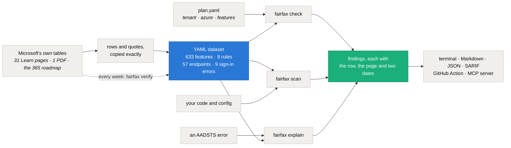

<div align="center">


# fairfax — check a Microsoft gov-cloud plan before you build it

**Give it your tenant type (GCC, GCC High or DoD), your Azure cloud and the features you plan to use, from Azure and Power Platform to Microsoft 365 Copilot, Teams, Purview and Intune. It tells you what Microsoft doesn't offer there, what can't cross between the clouds and what is retiring, and quotes the Microsoft row behind each answer.**

[](https://pypi.org/project/fairfax/)
[](https://github.com/intikhab49/fairfax/blob/main/LICENSE)
[](https://www.python.org/)
[](#the-dataset)
[](#scanning-code-for-wrong-cloud-endpoints)
[](https://github.com/intikhab49/fairfax/actions/workflows/watch.yml)

[Website](https://intikhab49.github.io/fairfax/) · [What it catches](#what-it-catches) · [Microsoft 365](#microsoft-365-and-the-roadmap) · [Sign-in errors](#sign-in-errors-decoded) · [Quick start](#quick-start) · [GitHub Action](#in-ci-the-github-action) · [MCP server](#for-coding-agents-the-mcp-server) · [The dataset](#the-dataset) · [FAQ](#faq)

</div>

---

## The problem

Microsoft's US government clouds are not copies of commercial Microsoft 365 and Azure. GCC, GCC High, DoD and Azure Government each lack features that commercial has, and some pairings of them can't talk to each other at all. A GCC tenant signs in through commercial Entra ID while its Power Platform runs in Azure Government. GCC High has its own endpoints for almost everything.

Microsoft does publish the gaps, spread across dozens of Learn pages, a PDF it republishes every few weeks and a roadmap. Most teams find them the expensive way, halfway through a build, when a connector never shows up, Copilot lacks the feature the pilot was built on, or a sign-in fails with `AADSTS900439`.

fairfax puts those tables in one place and checks a plan against them before anyone writes code. To look something up without installing anything, the same data is on the website as [availability tables](https://intikhab49.github.io/fairfax/availability/), one page per service, plus an [endpoints page](https://intikhab49.github.io/fairfax/endpoints/) and a page for each [cross-cloud sign-in error](https://intikhab49.github.io/fairfax/errors/).

## What it catches

The repo ships a made-up example: a state agency's field inspection app on GCC High and Azure Government. Supervisors approve reports by email or on their iPhones, Azure OpenAI drafts summaries, and Sentinel watches Teams.

```text
$ fairfax check examples/field-inspections/plan.yaml
fairfax check: Field inspection app (synthetic example)
tenant GCC High, Azure Government | 10 features | dataset of 633 features, pages checked 2026-10-12

BLOCKED (4)

  defender-for-cloud/ai-services
    Microsoft Defender for AI Services: not available in Azure Government.
    Works in commercial Azure (GA).
    source: Cloud feature availability for US Government customers
            page updated 2026-09-03, checked 2026-10-12
            https://learn.microsoft.com/en-us/azure/security/fundamentals/feature-availability#microsoft-defender-for-cloud
    row:    - Microsoft Defender for AI Services | GA | Not Available

  power-automate/actionable-approval-emails
    Actionable approval emails (Adaptive Cards in Outlook): not available in GCC High.
    Microsoft lists it for none of GCC, GCC High or DoD.
    ...

  power-automate/mobile-ios
    Power Automate mobile app for iOS: not available in GCC High.
    Works in GCC (GA).
    ...

  sentinel/connector/teams
    Teams data connector for Microsoft Sentinel: not available for GCC High tenants with Azure
    Government.
    Works for GCC tenants with commercial Azure (preview).
    ...

NOTES (1)
  ...
OK (6)
  azure-openai/gpt-4o  available in Azure Government
  defender-for-cloud/key-vault  generally available in Azure Government
  power-apps/canvas-teams-tab  generally available in GCC High
  ...

4 blocked, 0 cross-cloud, 0 retiring, 1 note, 6 ok
```

Four of the ten planned features don't exist in that cloud, and each finding shows where Microsoft says so. The app's code was copied from commercial samples, so the scanner finds the endpoints that would fail too:

```text
$ fairfax scan examples/field-inspections --plan examples/field-inspections/plan.yaml
fairfax scan: tenant GCC High, Azure Government

examples/field-inspections/app/settings.py
  9:23  login.microsoftonline.com  ->  login.microsoftonline.us
      Microsoft Entra ID sign-in: a GCC High tenant and Azure Government use
      login.microsoftonline.us.
      https://learn.microsoft.com/en-us/azure/azure-government/compare-azure-government-global-azure#guidance-for-developers
  10:24  graph.microsoft.com  ->  graph.microsoft.us
      Microsoft Graph: a GCC High tenant uses graph.microsoft.us.
      https://learn.microsoft.com/en-us/graph/deployments#microsoft-graph-and-graph-explorer-service-root-endpoints
  11:26  inspections-kv.vault.azure.net  ->  inspections-kv.vault.usgovcloudapi.net
  ...

6 wrong-cloud endpoints and 0 to check in 3 of 4 files scanned.
```

`check` exits 1 when anything is blocked and `scan` exits 1 on a wrong-cloud endpoint, so both work as CI gates. A bad plan or an unknown feature key exits 2.

## Microsoft 365 and the roadmap

Microsoft 365 Copilot, Teams, Exchange Online, SharePoint, OneDrive, Purview, Intune and Defender for Endpoint and XDR are in the dataset too, each row quoted from Microsoft's own per-cloud tables. When a feature is missing and Microsoft's public roadmap has an item for it, the finding shows the item and its target month, and says so when that month has passed. The second example is a GCC High collaboration rollout:

```text
$ fairfax check examples/m365-rollout/plan.yaml
fairfax check: Staff collaboration rollout (synthetic example)
tenant GCC High, no Azure cloud given | 11 features | dataset of 633 features, pages checked 2026-10-12

BLOCKED (7)
  ...
  m365-copilot/copilot-analytics
    Microsoft 365 Copilot: Copilot Analytics in Viva Insights: not available in GCC High.
    Works in GCC (available).
    Copilot Analytics in Viva Insights: A limited set of core metrics is currently available in GCC.
    Microsoft 365 roadmap 570428, "Microsoft Viva: Viva Insights and Copilot Analytics in GCC-High":
    In development for GCC High, target 2026-09. That month has passed, so check the roadmap for a
    newer date.
    https://www.microsoft.com/microsoft-365/roadmap?filters=&searchterms=570428
    source: Microsoft Copilot service description
            page updated 2026-08-21, checked 2026-10-12
            https://learn.microsoft.com/en-us/office365/servicedescriptions/office-365-platform-service-description/microsoft-365-copilot#feature-availability
    row:    Copilot Analytics in Viva Insights | Yes | Yes12 | Not currently available | Not
            currently available
  ...

7 blocked, 0 cross-cloud, 0 retiring, 1 note, 4 ok
```

Roadmap items are linked by hand, one at a time, and only where the item is the feature itself for a cloud where it's missing: 6 so far. One of them shows why both sources matter: the roadmap lists declarative agents with Actions as launched in GCC High and DoD, while the Copilot service description still says DoD doesn't have declarative agents. fairfax shows both and says so.

## Sign-in errors, decoded

When a commercial sign-in host meets a GCC High or Azure Government tenant, the error is a code. `fairfax explain` takes the code or the whole message and answers with Microsoft's wording, the cause and the right host for your clouds:

```text
$ fairfax explain AADSTS900439 --tenant gcchigh
AADSTS900439  USGClientNotSupportedOnPublicEndpoint
    Your app signed in a GCC High, DoD or Azure Government user through the commercial sign-in host,
    login.microsoftonline.com. Microsoft Entra ID has blocked that since 2020: users in US
    Government tenants must sign in through login.microsoftonline.us.

  Fix
    Point the app's authority at login.microsoftonline.us. If the app is registered in a commercial
    tenant and is meant to serve US Government users, Microsoft says it may need a new app
    registration in the US Government cloud.
    login.microsoftonline.us  for a GCC High tenant

    source: What's new for authentication?
    ...
```

It decodes 9 errors that mixing clouds causes, including `AADSTS90038`, `AADSTS90002`, `AADSTS900432` (the "Confidential Client isn't supported in Cross Cloud request" error) and `AADSTS700016`. `fairfax explain --list` shows them all, and each has a [page on the website](https://intikhab49.github.io/fairfax/errors/). Codes outside that list get a pointer to Microsoft's full error table instead of a guess.

## Quick start

```bash
pip install fairfax

fairfax facts --grep copilot                       # find feature keys and their status per cloud
fairfax check plan.yaml                            # text report
fairfax check plan.yaml --format md -o report.md   # or --format json, or --format sarif
fairfax scan src/ --tenant gcchigh --azure government
fairfax explain "AADSTS900439: ..."                # decode a cross-cloud sign-in error
fairfax verify                                     # re-read Microsoft's pages, confirm every cited row
fairfax mcp                                        # MCP server for coding agents
```

Python 3.10 or newer. The only dependency is PyYAML.

## In CI: the GitHub Action

```yaml
- uses: actions/checkout@v4
- uses: intikhab49/fairfax@v0.2.1
  with:
    plan: plan.yaml        # optional: check the plan's features
    scan: src              # paths to scan; the clouds come from the plan, or set tenant and azure
```

The action installs fairfax into its own virtual environment, so it leaves your job's Python alone. It writes both reports to the job summary, puts each finding on its line in the pull request, writes a SARIF file and fails the step when something is blocked or a host is from the wrong cloud. To see findings in the repository's Security tab as code-scanning alerts as well, add `upload-sarif: "true"` and give the job `permissions: security-events: write`.

| Input | Default | What it does |
|---|---|---|
| `plan` | | plan file to check; the scan also reads its clouds |
| `scan` | `.` | space-separated paths to scan; empty skips the scan |
| `tenant`, `azure` | | clouds for the scan when there's no plan |
| `exclude` | | space-separated globs the scan skips |
| `strict` | `false` | also fail on cross-cloud and retiring findings and on CHECK lines |
| `fail` | `true` | set to `false` to report without failing |
| `sarif` | `fairfax.sarif` | where to write the SARIF file |
| `upload-sarif` | `false` | upload the SARIF file to code scanning |

Without the action, `fairfax check plan.yaml --format sarif -o fairfax.sarif` and `fairfax scan src --format sarif` give you the same SARIF.

## For coding agents: the MCP server

`fairfax mcp` runs a [Model Context Protocol](https://modelcontextprotocol.io) server on stdio, so an agent asked "does this work in GCC High?" can answer from Microsoft's tables, with a citation, instead of guessing.

```bash
claude mcp add fairfax -- fairfax mcp          # Claude Code
```

```json
{ "servers": { "fairfax": { "command": "fairfax", "args": ["mcp"] } } }
```

The JSON goes in `.vscode/mcp.json` for VS Code. Cursor and other MCP clients use the same command, `fairfax mcp`. It has four read-only tools:

| Tool | Does |
|---|---|
| `find_features` | searches feature keys by product or name and shows each one's status per cloud |
| `check_plan` | checks a tenant, an Azure cloud and a list of feature keys, with Microsoft's row for each finding |
| `scan_code` | finds hosts from the wrong cloud in code it's given, or in local files |
| `explain_error` | decodes an AADSTS error from a code or the whole message |

It needs nothing beyond fairfax itself and never touches the network.

## Writing a plan

```yaml
name: Field inspection app
tenant: gcchigh        # gcc | gcchigh | dod
azure: government      # commercial | government (leave out if you have no Azure subscription)
features:
  - power-automate/actionable-approval-emails
  - sentinel/connector/teams
  - m365-copilot/researcher
```

Feature keys look like `service/feature`. `fairfax facts` lists all 633 with their status in each cloud, and `--grep` narrows the list. A key fairfax doesn't know is an error with suggestions, so a typo can't pass silently.

Each feature depends on one of three things:

| The answer depends on | Examples | Plan field |
|---|---|---|
| the Microsoft 365 tenant | Microsoft 365 Copilot, Teams, Exchange Online, SharePoint, OneDrive, Purview, Intune, Defender for Endpoint and XDR, and Power Platform (Power Apps, Power Automate, Power Pages, Copilot Studio, AI Builder) | `tenant` |
| the Azure cloud | Defender for Cloud, Sentinel features, Azure Machine Learning, Azure AI Language, Azure OpenAI models | `azure` |
| both | Sentinel's Microsoft 365 data connectors: a GCC tenant's data lives in commercial Azure, so a Sentinel workspace in Azure Government can't reach it | `tenant` and `azure` |

Findings land in five groups:

- **blocked**: not available, planned, in development, on Microsoft's engineering backlog, no plans, or only a future date from Microsoft. A target date that has passed is called out so you re-check it, and a linked roadmap item is shown with it.
- **cross-cloud**: Microsoft marks the pairing as not possible, or your tenant and your Azure subscription sit in different clouds.
- **retiring**: Microsoft has published a retirement date.
- **notes**: preview only, available with limits, rolling out, facts about how your clouds pair, and features a page doesn't cover for your cloud.
- **ok**: available, with the citation kept in the JSON and Markdown output.

## Scanning code for wrong-cloud endpoints

Code copied from commercial samples carries commercial hosts: `login.microsoftonline.com`, `graph.microsoft.com`, `*.vault.azure.net`, `api.security.microsoft.com`. `fairfax scan` finds them and names the right host for your clouds, using 57 mappings from Microsoft's endpoint tables.

It knows the GCC exception. A GCC tenant keeps the worldwide Entra ID and Graph endpoints, so those are fine for GCC. If the same plan also has an Azure Government subscription, the sign-in host is marked CHECK instead: it's right for calls to your GCC tenant and wrong for calls to Azure Government, and only you know which one a given line is for.

It also catches the hosts that GCC does *not* share with commercial, such as the Defender XDR API (`api-gcc.security.microsoft.us` for GCC, `api-gov.security.microsoft.us` for GCC High and DoD), and mix-ups between government tiers, such as a GCC High app calling the GCC Power BI API (`api.powerbigov.us` instead of `api.high.powerbigov.us`).

Add `fairfax: ignore` in a comment to skip a line, or `--exclude 'docs/*'` to skip paths. `--strict` makes CHECK lines fail too.

## Verifying the data against Microsoft

A dataset that quotes Microsoft is only as good as its quotes, so fairfax can check its own. `fairfax verify` fetches every page the dataset cites and confirms that each cited row and quote is still there, word for word, under the same section:

```text
$ fairfax verify
fairfax verify: 33 Microsoft pages, 1164 cited rows and quotes

ok          Azure Machine Learning feature availability across clouds regions                           24 of 24
ok          Microsoft Copilot service description                                                       25 of 25
ok          Microsoft 365 roadmap (public API)                                                          6 of 6
ok          Plan for Microsoft Purview compliance and risk management solutions – GCC High deployments  220 of 220
...
33 of 33 pages match.
```

When a row has changed, it prints the cited text next to the closest row on the page now, and exits 1. The Power Platform PDF is compared by its SHA-256, and the roadmap items against Microsoft's public roadmap API. A [workflow](https://github.com/intikhab49/fairfax/actions/workflows/watch.yml) in this repo runs it every Monday and opens an issue when Microsoft changes a page; the badge at the top shows its last result. After a clean run, `tools/mark_checked.py` moves each page's checked date forward.

## How it works



## The dataset


Every entry stores:

- the Microsoft page and the section anchor
- the row or quote, exactly as Microsoft wrote it (tick and cross images in Microsoft's tables are written as their file names, such as `[check-yes]`)
- the page's own updated date and the date fairfax last checked it
- a confidence level

The statuses were parsed from those rows, not retyped by hand ([`tools/build_facts.py`](https://github.com/intikhab49/fairfax/blob/main/tools/build_facts.py) built the 0.1 dataset and [`tools/build_m365.py`](https://github.com/intikhab49/fairfax/blob/main/tools/build_m365.py) the Microsoft 365 additions, with the same page reader that `fairfax verify` uses). A test re-parses the rows on every run, so an edit that changes a status without its row (or the other way round) fails.

Fourteen entries can't be a single row, and say so with `cite: summary`: 11 Azure OpenAI models, because Microsoft's tables list models as columns, and 3 Azure AI Language features whose finding is that the region table has no US Gov row. `fairfax verify` re-derives each one from the live page. Purview publishes one planning page per cloud, so each Purview feature has one entry per cloud, each citing its own page.

| Source | What fairfax takes from it | Page updated | Entries |
|---|---|---|---|
| [Cloud feature availability for US Government customers](https://learn.microsoft.com/en-us/azure/security/fundamentals/feature-availability) | Defender for Cloud in Azure Government, Sentinel's Microsoft 365 connectors per tenant type, GCC pairing | 2026-09-03 | 40 |
| [Microsoft Sentinel feature support](https://learn.microsoft.com/en-us/azure/sentinel/feature-availability) | Sentinel features and connectors in Azure Government | 2026-09-29 | 41 |
| [Business Applications availability in US Government clouds (PDF)](https://aka.ms/BAPFunctionalParity) | Power Platform features per GCC, GCC High and DoD | May 2026 | 70 |
| [Azure Machine Learning feature availability across clouds](https://learn.microsoft.com/en-us/azure/machine-learning/reference-machine-learning-cloud-parity) | Azure ML features and limits in Azure Government | 2026-05-19 | 24 |
| [Azure Language region support](https://learn.microsoft.com/en-us/azure/ai-services/language-service/concepts/regional-support) and the [custom text classification overview](https://learn.microsoft.com/en-us/azure/ai-services/language-service/custom-text-classification/overview) | which Language features have US Gov regions, one retirement date | 2026-07-22 | 5 |
| [Foundry Models sold by Azure in Azure Government](https://learn.microsoft.com/en-us/azure/foundry/foundry-models/concepts/models-sold-directly-by-azure-gov) | Azure OpenAI models and their deployment types per region | 2026-09-01 | 11 |
| [Microsoft Copilot service description](https://learn.microsoft.com/en-us/office365/servicedescriptions/office-365-platform-service-description/microsoft-365-copilot) | Microsoft 365 Copilot features per GCC, GCC High and DoD, with Microsoft's footnotes | 2026-08-21 | 25 |
| [Microsoft Teams service description](https://learn.microsoft.com/en-us/office365/servicedescriptions/teams-service-description) and [Teams for Government Clouds](https://learn.microsoft.com/en-us/microsoftteams/platform/concepts/cloud-overview) | Teams features and app capabilities per cloud | 2026-07-08, 2026-05-29 | 35 |
| [Exchange Online for US government environments](https://learn.microsoft.com/en-us/office365/servicedescriptions/office-365-platform-service-description/office-365-us-government/exchange-online-for-us-government-environments) | Exchange Online features per cloud, with Microsoft's key considerations | 2025-12-02 | 90 |
| [SharePoint](https://learn.microsoft.com/en-us/office365/servicedescriptions/office-365-platform-service-description/office-365-us-government/sharepoint) and [OneDrive](https://learn.microsoft.com/en-us/office365/servicedescriptions/office-365-platform-service-description/office-365-us-government/onedrive) for US government environments | the differences Microsoft lists, sentence by sentence | 2024-03-11, 2023-06-14 | 13 |
| Plan for Microsoft Purview: [GCC](https://learn.microsoft.com/en-us/office365/servicedescriptions/microsoft-365-service-descriptions/microsoft-365-tenantlevel-services-licensing-guidance/plan-for-microsoft-purview-gcc-deployments), [GCC High](https://learn.microsoft.com/en-us/office365/servicedescriptions/microsoft-365-service-descriptions/microsoft-365-tenantlevel-services-licensing-guidance/plan-for-microsoft-purview-gcc-high-deployments) and [DoD](https://learn.microsoft.com/en-us/office365/servicedescriptions/microsoft-365-service-descriptions/microsoft-365-tenantlevel-services-licensing-guidance/plan-for-microsoft-purview-dod-deployments) deployments | the status of each Purview feature in each cloud | 2026-08-25, 2025-12-02, 2025-12-02 | 661 |
| [Microsoft Intune for US Government GCC High and DoD](https://learn.microsoft.com/en-us/intune/fundamentals/government-service) | Intune features supported, planned and not available in GCC High and DoD | 2026-10-08 | 35 |
| [Defender for Endpoint](https://learn.microsoft.com/en-us/defender-endpoint/gov) and [Defender XDR](https://learn.microsoft.com/en-us/defender-xdr/usgov) for US Government, and the Defender API pages | feature parity per cloud, API hosts per cloud | 2026-09-17, 2026-06-26, 2026-04-13 | 20 |
| [Microsoft Entra error codes](https://learn.microsoft.com/en-us/entra/identity-platform/reference-error-codes), [What's new for authentication?](https://learn.microsoft.com/en-us/entra/identity-platform/reference-breaking-changes) and [National clouds](https://learn.microsoft.com/en-us/entra/identity-platform/authentication-national-cloud) | the cross-cloud sign-in errors and the sign-in host per cloud | 2026-06-15, 2026-08-26 | 9 |
| [Microsoft 365 roadmap](https://www.microsoft.com/microsoft-365/roadmap) (public API) | 6 roadmap items linked to missing features | 2026-09-11 | 6 |
| [Compare Azure Government and global Azure](https://learn.microsoft.com/en-us/azure/azure-government/compare-azure-government-global-azure) | the commercial-to-government endpoint table | 2026-08-18 | 46 |
| [Microsoft Graph national cloud deployments](https://learn.microsoft.com/en-us/graph/deployments) | Graph endpoints per cloud, the GCC exception, token rule | 2025-08-29 | 3 |
| Power Apps, Power Automate, Power BI and Dataverse US Government pages | portal, API and Dataverse hosts per tier, cross-cloud firewall rule | 2025-05-08 to 2026-08-14 | 8 |
| [Office 365 GCC service description](https://learn.microsoft.com/en-us/office365/servicedescriptions/office-365-platform-service-description/office-365-us-government/gcc) and [Security & Compliance PowerShell](https://learn.microsoft.com/en-us/powershell/exchange/connect-to-scc-powershell) | GCC support terms, compliance PowerShell hosts | 2025-12-02, 2026-08-27 | 2 |

Every entry is first-party Microsoft text except one rule marked **unverified**: whether a GCC tenant's Entra ID sign-in logs can reach a Sentinel workspace in Azure Government. Microsoft's tables don't cover it, so fairfax tells you that and says to test it. For four of the sign-in errors, the cause fairfax gives is the common one in US government setups rather than something Microsoft's row says; those are marked **medium** confidence.

## Limits

- **It only knows what is in the dataset.** 633 features is still a small part of Microsoft's catalog. If fairfax doesn't list a feature, that tells you nothing about whether it works.
- **Some Microsoft pages list only what's missing.** The Intune, SharePoint and OneDrive pages mostly list gaps, so a feature they don't mention isn't in fairfax at all. And the Intune page covers GCC High and DoD only; for GCC, fairfax says the page doesn't cover it.
- **For Azure OpenAI it lists the models Microsoft sells in Azure Government.** A model missing from `fairfax facts --grep azure-openai` isn't on that page.
- **Microsoft's sources can lag or disagree with each other.** Where two pages overlap, fairfax uses the more specific one and shows you the row so you can judge. Where the roadmap and a table disagree, it shows both.
- **Dates matter.** The Power Platform PDF is dated May 2026, and planned dates and roadmap months that have passed are flagged rather than trusted.
- **It doesn't read your tenant.** It checks a plan and your code. Checking a live tenant's configuration is a different job; CISA's ScubaGear checks Microsoft 365 tenants against its security baselines.
- **It is not compliance advice.** It tells you whether Microsoft offers a feature in a cloud, not whether your use of it meets FedRAMP, ITAR or CMMC.

## Roadmap

- **Next:** suggest alternatives when a feature is blocked; a boundary diagram with the cross-cloud sign-in recipes; more Microsoft 365 coverage (Entra ID features, Defender for Office 365 and Cloud Apps); a pre-commit hook.
- **Later:** rules for Bicep and Terraform, a read-only probe of a live Azure Government subscription, and FedRAMP and IL scope checks.

## Adding a fact

Add an entry to the matching file in [`src/fairfax/data/`](https://github.com/intikhab49/fairfax/tree/main/src/fairfax/data):

```yaml
  - id: defender-for-cloud.ai-services
    feature: defender-for-cloud/ai-services
    name: "Microsoft Defender for AI Services"
    by: azure                                   # azure | tenant | tenant+azure
    status: {commercial: ga, government: not-available}
    source: security-fa                         # a key in sources.yaml
    anchor: microsoft-defender-for-cloud        # the section's id on the page
    row: "- Microsoft Defender for AI Services | GA | Not Available"
    confidence: high
```

Copy the row exactly as Microsoft wrote it, then run `pytest` and `fairfax verify --source <key>`. The loader rejects unknown statuses, keys and sources, and verify fails if the row isn't on the page.

## FAQ

**How do I check whether a feature is available in GCC High or Azure Government?**
Run `pip install fairfax`, then `fairfax facts --grep <name>`. It shows the feature's status in each cloud and the Microsoft row behind it. The same data is browsable as [availability tables](https://intikhab49.github.io/fairfax/availability/), one page per service.

**Is Microsoft 365 Copilot available in GCC High and DoD?**
Yes, with gaps. Of the 25 Copilot features in Microsoft's service description, 8 aren't available in GCC High today, among them Copilot in Teams, Copilot in SharePoint and Edit with Copilot. DoD lacks a different set, including Researcher and Create. The [Copilot table](https://intikhab49.github.io/fairfax/availability/microsoft-365-copilot/) quotes each row.

**What is the difference between GCC, GCC High and DoD?**
They are separate US government clouds for Microsoft 365. GCC signs users in through commercial Entra ID (`login.microsoftonline.com`), while GCC High and DoD sign in through Azure Government (`login.microsoftonline.us`). Their feature sets differ too. Of the 70 Power Platform features fairfax tracks, 28 are not available today in GCC, 34 in GCC High and 45 in DoD ([table](https://intikhab49.github.io/fairfax/availability/power-platform/)).

**What does AADSTS900439 mean?**
Your app signed in a GCC High, DoD or Azure Government user through `login.microsoftonline.com`. Since 2020, users in US Government tenants must sign in through `login.microsoftonline.us`. `fairfax explain AADSTS900439` gives Microsoft's wording and the fix ([page](https://intikhab49.github.io/fairfax/errors/aadsts900439/)).

**Can a GCC tenant send data to Microsoft Sentinel in Azure Government?**
Not through the Microsoft 365 data connectors. Microsoft marks that pairing as not possible for all 13 connectors fairfax tracks, because a GCC tenant's data lives in commercial Azure ([Sentinel table](https://intikhab49.github.io/fairfax/availability/sentinel/)).

**Which endpoints does GCC High use?**
Among others, `login.microsoftonline.us` for sign-in, `graph.microsoft.us` for Microsoft Graph and `api-gov.security.microsoft.us` for the Defender XDR API. The [endpoints page](https://intikhab49.github.io/fairfax/endpoints/) lists all 57 mappings, and `fairfax scan` finds commercial hosts in your code.

**Can AI coding assistants use fairfax?**
Yes. `fairfax mcp` is an MCP server with tools to find features, check a plan, scan code and explain errors. In Claude Code: `claude mcp add fairfax -- fairfax mcp`.

**How do I know the data is still right?**
Run `fairfax verify`. It re-reads every page fairfax cites and confirms every cited row is still there. The weekly workflow does the same and opens an issue when Microsoft changes something.

**Does fairfax connect to my tenant or Azure subscription?**
No. It reads a plan file and your code on your own machine. The data ships inside the package. Only `fairfax verify` goes online, and only to fetch Microsoft's public pages.

**Is fairfax made by Microsoft?**
No. It is an independent MIT-licensed project that quotes Microsoft's documentation and links to every page it quotes.

## Why "fairfax"

Fairfax is what Microsoft's own code calls Azure Government, next to Mooncake for Azure China and Blackforest for the old Azure Germany. In the Azure Functions host, for example, `FairfaxStorageSuffix` is `core.usgovcloudapi.net` ([source](https://github.com/Azure/azure-functions-host/blob/08269604939797bf30b52c4dcb7077a2d57fc87b/src/WebJobs.Script/CloudConstants.cs#L8-L19)).

## License

MIT. Microsoft's documentation is quoted in short rows, and each one links to its page.
