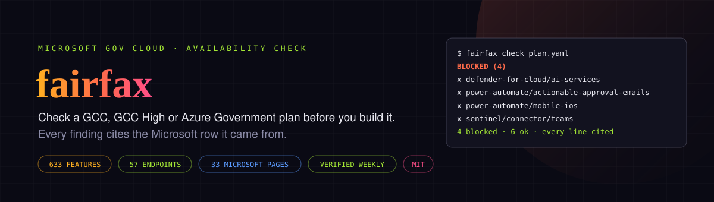
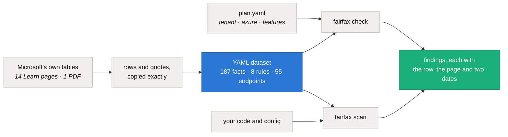
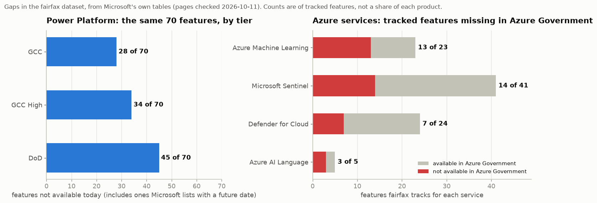

<div align="center">



# fairfax — check a Microsoft gov-cloud plan before you build it

**Give it your tenant type (GCC, GCC High or DoD), your Azure cloud and the features you plan to use. It tells you what Microsoft doesn't offer there, what can't cross between the clouds and what is retiring, and quotes the Microsoft row behind each answer.**

[](LICENSE)
[](https://www.python.org/)
[](#the-dataset)
[](#scanning-code-for-wrong-cloud-endpoints)
[](#the-dataset)

[What it catches](#what-it-catches) · [Quick start](#quick-start) · [Writing a plan](#writing-a-plan) · [Scanning code](#scanning-code-for-wrong-cloud-endpoints) · [The dataset](#the-dataset) · [Limits](#limits) · [Roadmap](#roadmap)

</div>

---

## The problem

Microsoft's US government clouds are not copies of commercial Microsoft 365 and Azure. GCC, GCC High, DoD and Azure Government each lack features that commercial has, and some pairings of them can't talk to each other at all. A GCC tenant signs in through commercial Entra ID while its Power Platform runs in Azure Government. GCC High has its own endpoints for almost everything.

Microsoft does publish the gaps, spread across a dozen Learn pages and a PDF it republishes every four to six weeks. Most teams find them the expensive way, halfway through a build, when a connector never shows up or a sign-in fails with a wrong-cloud error.

fairfax puts those tables in one place and checks a plan against them before anyone writes code.

## What it catches

The repo ships a made-up example: a state agency's field inspection app on GCC High and Azure Government. Supervisors approve reports by email or on their iPhones, Azure OpenAI drafts summaries, and Sentinel watches Teams.

```text
$ fairfax check examples/field-inspections/plan.yaml
fairfax check: Field inspection app (synthetic example)
tenant GCC High, Azure Government | 10 features | 187 facts, pages checked 2026-10-11

BLOCKED (4)

  defender-for-cloud/ai-services
    Microsoft Defender for AI Services: not available in Azure Government.
    Works in commercial Azure (GA).
    source: Cloud feature availability for US Government customers
            page updated 2026-09-03, checked 2026-10-11
            https://learn.microsoft.com/en-us/azure/security/fundamentals/feature-availability#microsoft-defender-for-cloud
    row:    - Microsoft Defender for AI Services | GA | Not Available

  power-automate/actionable-approval-emails
    Actionable approval emails (Adaptive Cards in Outlook): not available in GCC High.
    Microsoft lists it for none of GCC, GCC High or DoD.
    ...

  power-automate/mobile-ios
    Power Automate mobile app for iOS: not available in GCC High.
    Works in GCC (GA).
    ...

  sentinel/connector/teams
    Teams data connector for Microsoft Sentinel: not available for GCC High tenants with Azure
    Government.
    Works for GCC tenants with commercial Azure (preview).
    ...

NOTES (1)
  ...
OK (6)
  azure-openai/gpt-4o  available in Azure Government
  defender-for-cloud/key-vault  generally available in Azure Government
  power-apps/canvas-teams-tab  generally available in GCC High
  ...

4 blocked, 0 cross-cloud, 0 retiring, 1 note, 6 ok
```

Four of the ten planned features don't exist in that cloud, and each finding shows where Microsoft says so. The app's code was copied from commercial samples, so the scanner finds the endpoints that would fail too:

```text
$ fairfax scan examples/field-inspections --plan examples/field-inspections/plan.yaml
fairfax scan: tenant GCC High, Azure Government

examples/field-inspections/app/settings.py
  9:23  login.microsoftonline.com  ->  login.microsoftonline.us
      Microsoft Entra ID sign-in: a GCC High tenant and Azure Government use
      login.microsoftonline.us.
      https://learn.microsoft.com/en-us/azure/azure-government/compare-azure-government-global-azure#guidance-for-developers
  10:24  graph.microsoft.com  ->  graph.microsoft.us
      Microsoft Graph: a GCC High tenant uses graph.microsoft.us.
      https://learn.microsoft.com/en-us/graph/deployments#microsoft-graph-and-graph-explorer-service-root-endpoints
  11:26  inspections-kv.vault.azure.net  ->  inspections-kv.vault.usgovcloudapi.net
  ...

6 wrong-cloud endpoints and 0 to check in 3 of 4 files scanned.
```

`check` exits 1 when anything is blocked and `scan` exits 1 on a wrong-cloud endpoint, so both work as CI gates. A bad plan or an unknown feature key exits 2.

## Quick start

```bash
pip install git+https://github.com/intikhab49/fairfax

fairfax facts --grep sentinel                      # find feature keys and their status per cloud
fairfax check plan.yaml                            # text report
fairfax check plan.yaml --format md -o report.md   # or --format json
fairfax scan src/ --tenant gcchigh --azure government
fairfax facts --stale 90                           # cited pages due for another check
```

Python 3.10 or newer. The only dependency is PyYAML.

## Writing a plan

```yaml
name: Field inspection app
tenant: gcchigh        # gcc | gcchigh | dod
azure: government      # commercial | government (leave out if you have no Azure subscription)
features:
  - power-automate/actionable-approval-emails
  - sentinel/connector/teams
  - azure-openai/gpt-4o
```

Feature keys look like `service/feature`. `fairfax facts` lists all 187 with their status in each cloud, and `--grep` narrows the list. A key fairfax doesn't know is an error with suggestions, so a typo can't pass silently.

Each fact depends on one of three things:

| The answer depends on | Examples | Plan field |
|---|---|---|
| the Microsoft 365 tenant | Power Apps, Power Automate, Power Pages, Copilot Studio, AI Builder (Microsoft's PDF has GCC, GCC High and DoD columns) | `tenant` |
| the Azure cloud | Defender for Cloud, Sentinel features, Azure Machine Learning, Azure AI Language, Azure OpenAI models | `azure` |
| both | Sentinel's Microsoft 365 data connectors: a GCC tenant's data lives in commercial Azure, so a Sentinel workspace in Azure Government can't reach it | `tenant` and `azure` |

Findings land in five groups:

- **blocked**: not available, no plans, or only a future date from Microsoft. A target date that has already passed is called out so you re-check it.
- **cross-cloud**: Microsoft marks the pairing as not possible, or your tenant and your Azure subscription sit in different clouds.
- **retiring**: Microsoft has published a retirement date.
- **notes**: preview only, available with limits, and facts about how your clouds pair.
- **ok**: available, with the citation kept in the JSON and Markdown output.

## Scanning code for wrong-cloud endpoints

Code copied from commercial samples carries commercial hosts: `login.microsoftonline.com`, `graph.microsoft.com`, `*.vault.azure.net`. `fairfax scan` finds them and names the right host for your clouds, using 55 mappings from Microsoft's endpoint tables.

It knows the GCC exception. A GCC tenant keeps the worldwide Entra ID and Graph endpoints, so those are fine for GCC. If the same plan also has an Azure Government subscription, the sign-in host is marked CHECK instead: it's right for calls to your GCC tenant and wrong for calls to Azure Government, and only you know which one a given line is for.

It also catches mix-ups between government tiers, such as a GCC High app calling the GCC Power BI API (`api.powerbigov.us` instead of `api.high.powerbigov.us`).

Add `fairfax: ignore` in a comment to skip a line, or `--exclude 'docs/*'` to skip paths. `--strict` makes CHECK lines fail too.

## How it works



## The dataset



Every entry stores:

- the Microsoft page and the section anchor
- the row or quote, exactly as Microsoft wrote it
- the page's own updated date and the date fairfax last checked it
- a confidence level

The statuses were parsed from those rows, not retyped by hand ([`tools/build_facts.py`](tools/build_facts.py) is the script that did it). A test re-parses the rows on every run, so an edit that changes a status without its row (or the other way round) fails.

| Source | What fairfax takes from it | Page updated | Entries |
|---|---|---|---|
| [Cloud feature availability for US Government customers](https://learn.microsoft.com/en-us/azure/security/fundamentals/feature-availability) | Defender for Cloud in Azure Government, Sentinel's Microsoft 365 connectors per tenant type, GCC pairing | 2026-09-03 | 40 |
| [Microsoft Sentinel feature support](https://learn.microsoft.com/en-us/azure/sentinel/feature-availability) | Sentinel features and connectors in Azure Government | 2026-09-29 | 41 |
| [Business Applications availability in US Government clouds (PDF)](https://aka.ms/BAPFunctionalParity) | Power Platform features per GCC, GCC High and DoD | May 2026 | 70 |
| [Azure Machine Learning feature availability across clouds](https://learn.microsoft.com/en-us/azure/machine-learning/reference-machine-learning-cloud-parity) | Azure ML features and limits in Azure Government | 2026-05-19 | 24 |
| [Azure Language region support](https://learn.microsoft.com/en-us/azure/ai-services/language-service/concepts/regional-support) and the [custom text classification overview](https://learn.microsoft.com/en-us/azure/ai-services/language-service/custom-text-classification/overview) | which Language features have US Gov regions, one retirement date | 2026-07-22 | 5 |
| [Foundry Models sold by Azure in Azure Government](https://learn.microsoft.com/en-us/azure/foundry/foundry-models/concepts/models-sold-directly-by-azure-gov) | Azure OpenAI models and their deployment types per region | 2026-09-01 | 11 |
| [Compare Azure Government and global Azure](https://learn.microsoft.com/en-us/azure/azure-government/compare-azure-government-global-azure) | the commercial-to-government endpoint table | 2026-08-18 | 46 |
| [Microsoft Graph national cloud deployments](https://learn.microsoft.com/en-us/graph/deployments) | Graph endpoints per cloud, the GCC exception, token rule | 2025-08-29 | 3 |
| Power Apps, Power Automate, Power BI and Dataverse US Government pages | portal, API and Dataverse hosts per tier, cross-cloud firewall rule | 2025-05-08 to 2026-08-14 | 8 |
| [Office 365 GCC service description](https://learn.microsoft.com/en-us/office365/servicedescriptions/office-365-platform-service-description/office-365-us-government/gcc) and [Security & Compliance PowerShell](https://learn.microsoft.com/en-us/powershell/exchange/connect-to-scc-powershell) | GCC support terms, compliance PowerShell hosts | 2025-12-02, 2026-08-27 | 2 |

Every entry is first-party Microsoft text except one rule marked **unverified**: whether a GCC tenant's Entra ID sign-in logs can reach a Sentinel workspace in Azure Government. Microsoft's tables don't cover it, so fairfax tells you that and says to test it.

`fairfax facts --stale 90` lists the pages due for another check, and a scheduled workflow in this repo runs it every week.

## Limits

- **It only knows what is in the dataset.** 187 features is a small part of Microsoft's catalog. If fairfax doesn't list a feature, that tells you nothing about whether it works.
- **For Azure OpenAI it lists the models Microsoft sells in Azure Government.** A model missing from `fairfax facts --grep azure-openai` isn't on that page.
- **Microsoft's tables can lag or disagree with each other.** Where two pages overlap, fairfax uses the more specific one, such as the tenant-by-cloud connector matrix over the general Sentinel list, and shows you the row so you can judge.
- **Dates matter.** The Power Platform PDF is dated May 2026, and planned dates that have passed are flagged rather than trusted.
- **It doesn't read your tenant.** It checks a plan and your code. Checking a live tenant's configuration is a different job; CISA's ScubaGear checks Microsoft 365 tenants against its security baselines.
- **It is not compliance advice.** It tells you whether Microsoft offers a feature in a cloud, not whether your use of it meets FedRAMP, ITAR or CMMC.

## Roadmap

- **Next:** decode cross-cloud sign-in errors such as `AADSTS900439` into cause and fix; show Microsoft 365 roadmap dates on blocked findings; an MCP server so coding agents can ask fairfax instead of guessing.
- **Later:** a drift watcher that re-reads each cited page and flags rows that changed, rules for Bicep and Terraform, a read-only probe of a live Azure Government subscription, and FedRAMP and IL scope checks.

## Adding a fact

Add an entry to the matching file in [`src/fairfax/data/`](src/fairfax/data):

```yaml
  - id: defender-for-cloud.ai-services
    feature: defender-for-cloud/ai-services
    name: "Microsoft Defender for AI Services"
    by: azure                                   # azure | tenant | tenant+azure
    status: {commercial: ga, government: not-available}
    source: security-fa                         # a key in sources.yaml
    anchor: microsoft-defender-for-cloud        # the section's id on the page
    row: "- Microsoft Defender for AI Services | GA | Not Available"
    confidence: high
```

Copy the row exactly as Microsoft wrote it, then run `pytest`. The loader rejects unknown statuses, keys and sources.

## Why "fairfax"

Fairfax is what Microsoft's own code calls Azure Government, next to Mooncake for Azure China and Blackforest for the old Azure Germany. In the Azure Functions host, for example, `FairfaxStorageSuffix` is `core.usgovcloudapi.net` ([source](https://github.com/Azure/azure-functions-host/blob/08269604939797bf30b52c4dcb7077a2d57fc87b/src/WebJobs.Script/CloudConstants.cs#L8-L19)).

## License

MIT. Microsoft's documentation is quoted in short rows, and each one links to its page.
